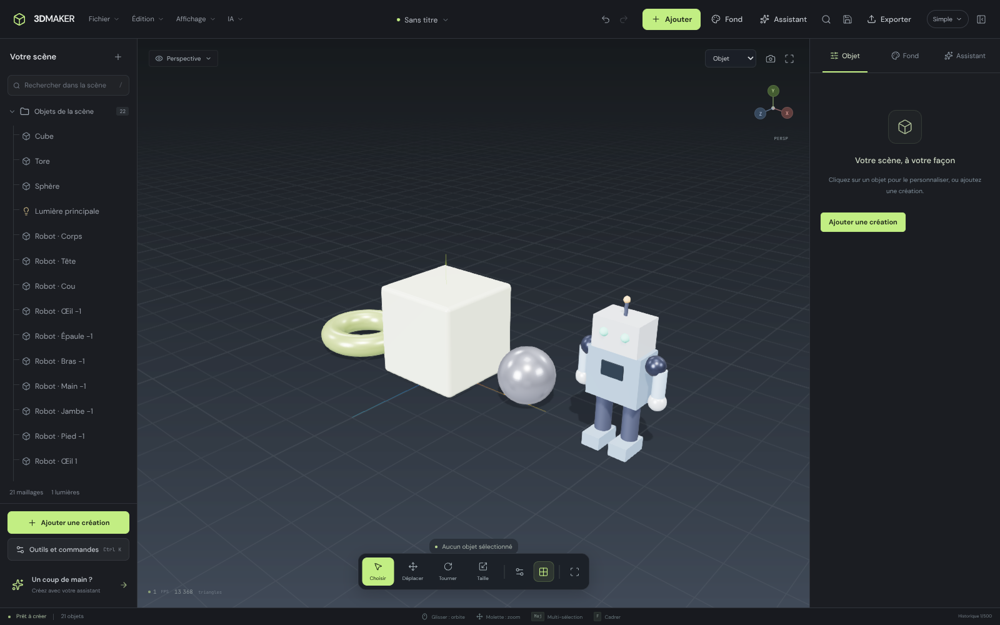
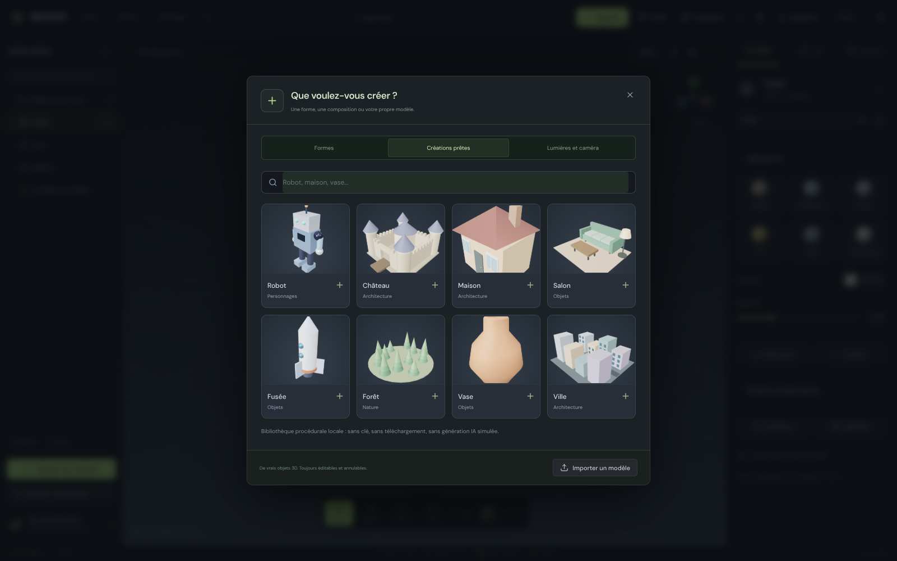

# 3DMAKER

**Studio de modélisation 3D en français, avec reconstruction photo → 3D et assistant de scène connectés à de vraies API.** Application Electron plein écran, mode Simple par défaut, thème sombre, rendu Three.js, React et TypeScript strict. Les opérations modifient de véritables maillages : la scène présentée n’est pas une image ni une maquette d’interface.



## Démarrer et produire l’installateur Windows

Prérequis : **Node.js 26.11.1** recommandé (`.nvmrc`), npm, Windows 10/11 **x64** pour la livraison native, pilote graphique avec WebGL 2. Une connexion Internet est nécessaire pour installer les dépendances et télécharger Electron/NSIS la première fois. Les services IA nécessitent leur propre compte/clé ou un serveur local compatible.

Dans le dossier du projet :

```bash
npm install
npm run dev
npm run dist
```

- `npm run dev` ouvre l’application Electron et démarre Vite sur le port 5173. Arrêtez une éventuelle autre instance utilisant ce port. React se recharge à chaud ; après une modification du processus principal ou du preload, relancez la commande.
- `npm run dist` effectue les trois vérifications TypeScript, compile l’interface et les workers, compile Electron, puis construit l’installateur NSIS français.
- **Fichier attendu : `out/forge3d-setup.exe`**. Le produit installé et son raccourci s’appellent **3DMAKER**.
- L’exécutable est **non signé** par défaut. Windows peut afficher un avertissement SmartScreen. Pour une distribution signée, activez `win.signExecutable` dans `electron-builder.yml` et configurez votre certificat dans votre environnement de build ; aucune clé de signature n’est fournie.
- Il n’est pas nécessaire de copier `node_modules` ou les sources dans l’installation : les deux processus Electron et le rendu sont compilés, les ressources sont locales et empaquetées en ASAR.

**État de vérification de cette livraison, 11 octobre 2026 :** compilation de production réussie sous Node 26.11.1, **139 tests automatisés réussis**, trois scénarios navigateur réussis avec Chromium 153 (modélisation avancée, espace Simple et fournisseurs Claude/Venice). La chaîne photo/API/galerie et le chat ont été exercés avec des réponses HTTP de test, pas avec une inférence cloud facturée. Le téléchargement des binaires Electron est bloqué dans l’environnement de réalisation : **l’installateur `.exe` n’est pas fourni et son exécution native n’a pas été vérifiée ici**. La configuration de construction est fournie ; exécutez `npm run dist` sur votre machine connectée.

## Prise en main

1. Cliquez **Ajouter** : choisissez une forme, une création prête, une lumière ou une caméra. Les créations sont ajoutées à côté des objets existants, sans les remplacer. **Déplacer**, **Tourner** et **Taille** sont les trois outils directs de la vue.
2. Maintenez **Maj** pour sélectionner plusieurs objets. L’arborescence permet de sélectionner, renommer, masquer et verrouiller les objets.
3. Le bouton **Simple / Expert** révèle les outils avancés sans les perdre. Passez en **Sommets / Arêtes / Faces** pour sélectionner et déplacer des composants. **Suppr** enlève les composants sélectionnés et leurs faces incidentes, pas implicitement l’objet entier. **Ctrl A** sélectionne tous les composants dans ces modes.
4. Utilisez **Modélisation avancée** pour effectuer une opération réelle. Un calcul terminé correspond à une action d’annulation. Une scène modifiée pendant un calcul provoque son rejet plutôt qu’une application sur des données périmées.
5. Les onglets **Objet / Fond / Assistant** regroupent les tâches. Dans Objet, choisissez un matériau en un clic, posez au sol, centrez et ouvrez **Position et dimensions** si nécessaire. **F10** masque les panneaux, **Ctrl K** trouve une commande.
6. **Ctrl S** enregistre le projet `.3dmaker`, incluant géométrie, matériaux, textures, éclairages, caméras et réglages. La récupération automatique locale ne remplace pas ce fichier de projet.

### Navigation et raccourcis

| Commande                                        | Action                                                              |
| ----------------------------------------------- | ------------------------------------------------------------------- |
| Glisser gauche                                  | Orbiter autour de la scène                                          |
| Glisser droit                                   | Déplacer la vue ; un clic droit immobile ouvre le menu contextuel   |
| Molette                                         | Zoomer                                                              |
| Maj + clic                                      | Multisélection d’objets ou de composants                            |
| V / W / E / R                                   | Sélection / translation / rotation / échelle                        |
| X / Y / Z                                       | Verrouiller l’axe du gizmo ; Z en mode Sélection bascule le filaire |
| F / Début                                       | Cadrer la sélection / toute la scène                                |
| Tab / 1 / 2 / 3                                 | Objet ↔ dernier mode de maillage / sommets / arêtes / faces         |
| Maj Tab                                         | Activer/désactiver l’accrochage                                     |
| Maj D / Ctrl J / Suppr                          | Dupliquer les objets / fusionner / supprimer                        |
| Ctrl Z / Ctrl Maj Z / Ctrl Y                    | Annuler / rétablir                                                  |
| Échap pendant un glissement                     | Annuler le geste en cours sans créer d’entrée d’historique          |
| M                                               | Mesurer une distance entre deux points du maillage, en mètres       |
| Pavé 1 / Ctrl Pavé 1 / Pavé 3 / Pavé 7 / Pavé 5 | Face / arrière / droite / dessus / perspective ↔ orthographique     |
| Ctrl N / Ctrl O / Ctrl S / Ctrl E               | Nouveau projet / import / enregistrement / export                   |
| Ctrl K / F10                                    | Palette de commandes / mode concentration                           |
| F11 / ? / /                                     | Plein écran / aide / recherche dans la scène                        |

L’aide et les infobulles sont disponibles dans l’interface. Les menus restent plats, avec au maximum un sous-menu.

## Bibliothèque et fonds, sans configuration



**Ajouter → Créations prêtes** contient huit compositions : robot, château, maison, salon, fusée, forêt, vase et ville. Ce sont de **vrais maillages procéduraux éditables**, avec des miniatures rendues par Three.js, pas des images à la place de modèles et **pas une inférence IA**. Aucun compte ni connexion ne sont nécessaires. Chaque ajout est annulable en une seule action ; ses pièces peuvent ensuite être modifiées ou exportées.

Dans **Fond**, choisissez couleur unie, dégradé, photo ou environnement HDR. Six palettes, intensité, exposition, orientation et grille restent accessibles sans ouvrir les réglages experts. Les photos PNG/JPEG/WebP sont décodées et intégrées au projet, limitées à 20 Mo et réduites à 2048 px ; le mode photo conserve les proportions et recadre au centre. Les anciens projets gardent leur fond uni. **Rendu rapide → PNG → Fond transparent** exporte réellement un canal alpha, sans grille ni gizmo, en conservant l’éclairage des objets.

## Modélisation et rendu

- **8 primitives** : cube, sphère, cylindre, cône, tore, plan, tube courbe et boîte creuse. La boîte est un solide fermé sans faces internes superposées ; le plan et le tube ouvert sont des surfaces.
- Sélection d’objets/composants, gizmos, coordonnées précises, duplication, fusion, alignement sur le premier objet sélectionné, axes verrouillés, accrochage et mesure.
- **Extrusion** d’une région de faces avec raccords. Sans région sélectionnée, déplacement de toute la surface le long de ses normales.
- **Chanfrein** des contours, avec regroupement coplanaire, triangulation conservant les trous et limitation de largeur sur les zones fines.
- **Subdivision de Loop**, éventuellement sans lissage ; **décimation Meshoptimizer** avec préservation des bords et borne d’erreur ; miroir local avec réorientation des faces ; répétition linéaire.
- **Spin** : extrusion angulaire raccordée d’un profil plan, avec axe et centre configurables. À 360°, les extrémités sont soudées ; un arc partiel reçoit des bouchons. Utilisez un plan ou une région de faces, avec l’axe dans le plan et hors de la section. Ce n’est pas une simple duplication circulaire.
- **Révolution** : échantillonnage du profil radial autour de l’axe Y local. **Suivre un chemin** : section convexe XY extrudée le long d’une courbe de Catmull–Rom.
- **Union / différence / intersection** : CSG avec BVH, dans un worker. Deux volumes fermés sont nécessaires ; les surfaces ouvertes sont refusées avec un message français. La différence retire le second objet sélectionné du premier. Les résultats vides sont signalés sans remplacement destructeur.
- PBR physique : albédo, rugosité, métal, émission, opacité, transmission/réfraction, vernis et anisotropie. Six canaux PNG/JPG/HDR : albédo, normale, rugosité, métal, émission et AO. L’acier brossé possède une normal map procédurale réelle et une anisotropie directionnelle ; le verre utilise la transmission.
- Éclairages ambiant, directionnel, ponctuel et projecteur, cibles et ombres réglables. FXAA, ACES, AgX filmique, gamma, exposition et brouillard.
- Environnement de studio et panoramas HDR procéduraux Soleil/Nuit intégrés, sans téléchargement ; import d’un environnement Radiance `.hdr` personnel.
- **500 entrées d’historique** en mémoire. Transformations, composants, matériaux, lumières, caméras, imports, résultats IA, paramètres de rendu et changements de projet sont annulables. Un geste de gizmo ou de curseur constitue une transaction. La navigation de vue, les exports et les préférences API ne sont pas des mutations de scène.

Les opérations topologiques recalculent leurs normales et UV. Pour conserver l’aspect exact d’un dépliage UV complexe, gardez une copie avant de modifier la topologie. Les fusions et booléennes héritent du matériau du premier objet.

## Import, export et images

**OBJ, FBX, GLTF, GLB, STL** : import et export. Glissez les modèles dans la vue ou utilisez **Fichier → Importer**. Sélectionnez ensemble les fichiers compagnons : MTL, BIN et images. GLB et GLTF intégrés sont les formats recommandés pour transporter le PBR ; Draco et Meshopt sont pris en charge et les décodeurs sont embarqués.

- Les modèles sont importés comme maillages statiques éditables, avec transformations de hiérarchie appliquées. Les parties utilisant des matériaux différents sont séparées. Les animations et rigs ne constituent pas un système d’animation dans cet éditeur.
- Les exports de modèles portent sur les maillages visibles, ou explicitement sur la sélection. Le projet `.3dmaker` conserve aussi les lumières, caméras et paramètres de scène.
- **GLB / GLTF** : géométrie, UV et matériaux PBR, textures intégrées. Les textures HDR de surface sont converties en PNG pour ces formats ; le projet natif conserve les HDR originales.
- **OBJ** : OBJ + MTL + textures cohérents dans le même dossier sous Electron ; archive ZIP dans l’aperçu navigateur. Le modèle de matériau MTL n’exprime pas toutes les propriétés PBR modernes.
- **FBX** : véritable FBX 7.4 ASCII, transformations, UV, matériaux de surface et textures intégrées. La transmission et les extensions PBR propres à GLTF ne sont pas entièrement exprimées par le matériau FBX classique.
- **STL** : triangles et normales, transformations appliquées, sans couleurs ni textures. Vérifiez la fermeture du maillage avant impression.
- **Rendu rapide** : aperçu calculé sur la vraie scène, PNG/JPEG à 95 %, résolutions personnalisées jusqu’à 8192 px par axe selon le GPU ; captures HD, 4K et carrées, fond transparent en PNG. Les panneaux, axes de sélection et gizmos ne sont pas capturés.

## Connecter l’IA

Ouvrez **Assistant → Connecter l’IA**, ou **IA → Paramètres IA**. Aucun faux modèle ni réponse de remplacement n’est généré si un fournisseur manque ou échoue.

### Photo → modèle

- **Meshy** : renseignez votre clé, le modèle et la cible de triangles. La qualité Rapide/Équilibrée/Haute utilise 35/65/100 % de la cible. Création de tâche, suivi réel, téléchargement GLB/GLTF et textures PBR.
- **Stability Fast 3D** : photo multipart, retour GLB texturé, qualité de texture 512/1024/2048. Le paramètre de sommets est dérivé de la cible de triangles.
- **API personnalisée / Luma via passerelle** : votre serveur doit respecter [le contrat HTTP documenté](docs/API.md). Le choix Luma ne suppose pas qu’un service vidéo ou NeRF retourne directement un GLTF ; une passerelle photo → modèle adaptée est nécessaire.

Importez une photo **PNG/JPG, 20 Mo maximum, au moins 64 × 64 px**. Elle est ramenée à 2048 px sur son côté le plus long si nécessaire. Cliquez **Générer le modèle 3D**. Les étapes françaises utilisent la progression du fournisseur lorsqu’elle existe ; les fournisseurs synchrones affichent des étapes, pas un temps de calcul inventé.

Le modèle reçu est réellement chargé, centré en X/Z, posé au sol, normalisé à 3 mètres sur son plus grand côté, sélectionné et éditable/exportable. La galerie persiste sur disque ; les modèles binaires ne sont chargés qu’à la demande. **Arrêter le suivi n’annule pas une tâche déjà acceptée chez le fournisseur** : vérifiez son tableau de bord avant de relancer pour éviter une double facturation.

### Assistant de scène

Les services sont préconfigurés ; ils ne contiennent **aucune clé ni crédits offerts** :

- **OpenAI · capacité élevée** : `https://api.openai.com/v1`, modèle proposé `gpt-6-sol`, raisonnement approfondi, contexte de scène et vue optionnelle. Ajoutez votre clé personnelle, cliquez **Détecter** pour connaître les modèles autorisés à votre compte, puis **Tester l’IA**. Le nom proposé n’établit pas un droit d’accès : votre disponibilité et les capacités effectives doivent être vérifiées.
- **OpenAI · rapide** : proposition `gpt-5.4-mini`, adaptée aux modifications quotidiennes.
- **Claude · Opus / Sonnet / Haiku** : API Anthropic native `https://api.anthropic.com/v1`, avec les noms proposés `claude-opus-5-5`, `claude-sonnet-5-5` et `claude-haiku-5-5`. Ajoutez votre **clé API Anthropic** ; l’abonnement au site Claude n’est pas une clé API. **Détecter** consulte les modèles réellement retournés par votre compte, en conservant si possible la famille choisie, puis **Tester l’IA** vérifie une réponse native. Les noms proposés proviennent du catalogue typé du SDK officiel, pas d’une preuve de droits d’accès.
- **Venice.ai** : API `https://api.venice.ai/api/v1`, **clé API Venice** personnelle, modèle proposé `default` (trait résolu par Venice). **Détecter** affiche les modèles textuels du catalogue et leurs capacités déclarées, en excluant les modèles hors ligne. Le modèle par défaut peut changer chez Venice ; choisissez un nom précis pour le figer. La vision est désactivée au départ, car tous les modèles ne l’acceptent pas.
- **Ollama** : serveur `http://127.0.0.1:11434/v1`, proposition `qwen3:8b`, sans clé. Installez Ollama, exécutez `ollama pull qwen3:8b`, puis `ollama serve`. Un modèle disponible peut être détecté et sélectionné automatiquement au premier démarrage. Aucun LLM n’est embarqué ni téléchargé en secret ; sa vitesse dépend de la RAM/VRAM.
- **LM Studio / serveur personnalisé** : démarrez un serveur compatible OpenAI, choisissez un modèle installé, puis testez-le. Une adresse locale désigne **la machine qui exécute 3DMAKER**, pas le navigateur du visiteur.

**Détecter** utilise réellement `GET /models`. **Tester l’IA** envoie une petite requête d’inférence réelle et contrôle le JSON retourné sans toucher à la scène ; les coûts du fournisseur peuvent s’appliquer. Une simple réponse HTTP réussie ne suffit pas à annoncer une IA connectée.

La vue optionnelle transmet une capture **896 × 672** au modèle ; désactivez-la avec un modèle sans vision ou pour ne pas envoyer cette image. Le contexte inclut la sélection prioritaire, les transformations, matériaux, lumières, caméras et réglages de scène, sans intégrer les données binaires des textures dans le texte. Les préréglages locaux et Venice désactivent la vision par défaut. Après détection, les options de vision ou de JSON structuré explicitement non supportées par un modèle sont désactivées ; les plans en texte JSON restent toujours validés. Choisissez un modèle capable de respecter le contrat JSON ; le paramètre de réponse structurée peut être désactivé pour une passerelle qui ne le reconnaît pas.

Claude reçoit des messages au format natif Anthropic, avec `system` séparé, image JPEG base64 et clés authentifiées uniquement par le backend. En mode JSON, Claude utilise un outil **de proposition de plan**, jamais un outil de code ou de commande système. Venice conserve le format OpenAI, sans recherche web automatique ni ajout d’un prompt système concurrent ; le raisonnement textuel n’est pas interprété comme un plan. Les capacités et limites reçues des catalogues sont utilisées, pas supposées.

**Ces fournisseurs sont ajoutés à l’assistant de scène.** Ils ne remplacent pas les services spécialisés de reconstruction photo → GLB/GLTF. La vue optionnelle aide l’assistant à proposer des commandes de scène ; elle ne prétend pas transformer directement une photo en modèle neuronal texturé.

Exemples de demandes :

- « Rends ce cube en acier brossé rouge. »
- « Ajoute une sphère bleue brillante et une lumière orange en dessous. »
- « Crée un château avec quatre tours, des remparts et une caméra face à l’entrée. »

**Par défaut, un plan est préparé et validé dans un worker sans modifier la scène**. Consultez-le, puis choisissez **Appliquer le plan** ou **Ignorer**. Une scène modifiée pendant la réponse ou après la proposition rend le plan périmé. L’application est **atomique, en une seule action annulable**, y compris une composition complète. La validation peut être désactivée dans les paramètres pour une application directe. Aucun `eval`, code JavaScript, commande système ou accès arbitraire aux fichiers n’est exécuté. Une réponse invalide, une cible verrouillée ou une scène devenue obsolète n’applique pas partiellement le plan. L’assistant peut construire les huit créations locales, les compléter par primitives, matériaux et transformations, poser/centrer les objets, régler les lumières, caméras et fonds, et utiliser les opérations de maillage documentées. La précision de l’interprétation et de la reconstruction dépend du fournisseur choisi ; le logiciel n’invente pas une inférence réussie. **Aucune inférence cloud facturée ni aucun LLM local installé n’a été vérifié dans cet environnement.**

## Stockage et sécurité

- Electron : clés protégées par `safeStorage` du système, IPC typée et contrôlée par origine, renderer sandboxé sans intégration Node, isolation de contexte et protocole local `app://studio` avec CSP. Les clés ne sont pas exportées avec les projets.
- Paramètres et galerie dans le dossier utilisateur Electron, sous `data/` (Windows : généralement `%APPDATA%/3DMAKER/data`). Chaque génération possède une fiche JSON et un fichier `.model` ; supprimer une fiche dans la galerie supprime aussi ce binaire.
- Scène récupérable dans IndexedDB ; enregistrement de projet natif distinct, avec confirmation avant de fermer une scène modifiée.
- `npm run dev:web` : aperçu navigateur avec pont HTTP relatif, sans appel navigateur vers un faux `localhost` de backend. Son stockage est `~/.3dmaker-preview`, avec fichiers privés **mais clés non chiffrées**. Ne publiez pas cet aperçu avec des clés sensibles ; préférez l’application Electron pour un usage personnel réel. `THREEDMAKER_PREVIEW_DATA` permet un dossier de test isolé.
- Changer l’origine du serveur de chat efface la clé précédente dans l’interface ; les requêtes authentifiées restent sur l’origine configurée. La détection locale interroge uniquement le serveur Ollama fixe et n’envoie jamais la clé cloud.
- Limites de protection : fichiers/réponses de modèles de 180 Mo, image de 20 Mo, HDR de 32 Mo, calculs de cinq minutes, suivi de génération de vingt minutes et plans de 200 actions. Les boîtes de dialogue expliquent les erreurs plutôt que d’afficher un succès fictif.

## Développement et vérification

Les résultats constatés et les limites de validation sont détaillés dans [VERIFICATION.md](docs/VERIFICATION.md).

```bash
npm run typecheck
npm test
npm run build
```

Scénario navigateur reproductible (il crée un stockage et un serveur HTTP de test temporaires ; aucune clé cloud nécessaire) :

```bash
npx playwright install chromium
npm run test:browser
npm run test:browser:simple
npm run test:browser:providers
```

Le premier scénario (mode Expert) teste les huit boutons de primitives, les transformations numériques, les trois gizmos par glissement souris et leur historique, le chanfrein et Spin dans les workers, la suppression de composants, une union, les cinq exports puis réimports, l’intégration photo → tâche → téléchargement → galerie, une action de chat réelle et une capture 1920 × 1080. **Ses réponses IA sont des fixtures de test clairement séparées du code applicatif, et non une preuve d’inférence cloud.** Le second teste le mode Simple, les coordonnées/poser au sol et leur annulation, Ctrl K, F10, la bascule Expert, les quatre types de fond (dont une vraie photo), l’historique de bibliothèque, un PNG avec alpha inspecté pixel par pixel, la découverte des modèles, le test d’inférence HTTP, la capture multimodale, le plan/appliquer/annuler et le refus d’une proposition périmée. Le troisième teste les préréglages Claude, le catalogue paginé et l’authentification native, la conversion JPEG en bloc image Anthropic, les propositions `tool_use`, Venice avec Bearer et capacités de catalogue, la vision compatible OpenAI, la désactivation des options non prises en charge, les modifications/annulations et les paramètres persistants. Il redirige les appels cloud vers des fixtures HTTP **uniquement dans le scénario de test**. Les captures de test sont écrites sous `.arena/`, hors sources livrées.

Une archive complète des sources, sans dépendances, clés ni fichiers de travail :

```bash
npm run package:sources
```

Sortie : `release/3DMAKER-sources.zip`.

### Organisation du projet

```text
electron/                 main sécurisé, preload typé, réseau et stockage
src/components/           interface React française
src/store/                scène/historique Zustand et état IA
src/engine/               géométrie, workers, rendu, PBR, HDRI, import/export
src/services/             pont, photo/API, chat et plans, raccourcis, autosave
src/shared.ts             contrats Electron / renderer et paramètres IA
scripts/                  développement, compilation Electron, archive sources
public/                   icônes et décodeurs Draco locaux
tests/                   suites géométrie/historique/IO/IA/backend + navigateur
docs/                    contrat API et notices tiers
```

Versions verrouillées dans `package-lock.json` : Electron 44.7, React 19.3, Three.js 0.186.1, Zustand 5.0.15, TypeScript 7.0.2, Vite 8.3.4, Tailwind 4.3.3 et Electron Builder 26.15.3. Elles correspondent aux versions stables consultées lors de cette réalisation. Les polices DM Sans/JetBrains Mono et les HDRI intégrées fonctionnent sans CDN.

### Dépannage

- **Electron ne démarre pas après l’installation** : vérifiez que l’installation n’a pas désactivé les scripts npm et que les téléchargements GitHub/CDN sont autorisés. Relancez `npm install` une fois le réseau rétabli. N’utilisez pas une désactivation de la vérification TLS ; sur un réseau d’entreprise, configurez votre certificat racine ou `NODE_OPTIONS=--use-system-ca` sous Node 26.
- **Erreur WebGL** : mettez à jour le pilote graphique et vérifiez WebGL 2. Les FPS du rendu logiciel d’un environnement de test ne constituent pas un benchmark du GPU de votre ordinateur.
- **API 401/402/429** : clé, crédits et quota sont ceux du fournisseur ; aucun crédit ni clé n’est inclus.
- **Ressource manquante à l’import** : ajoutez MTL/BIN/images en même temps que le modèle, ou exportez-le en GLB intégré.
- **Booléenne refusée** : un plan ou tube non bouché n’est pas un volume fermé ; utilisez un solide ou corrigez les bords ouverts.

Licence du projet : [MIT](LICENSE). Notices des bibliothèques et fontes : [THIRD-PARTY-NOTICES](docs/THIRD-PARTY-NOTICES.md).
